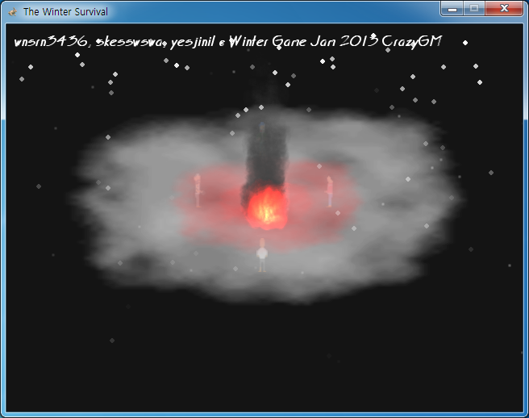
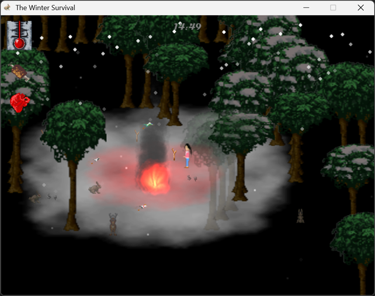

# 겨울나기

[English](README.md)

눈 내리는 숲에서 15분을 버티는 생존 게임이다. 체온과 포만감이 계속 떨어지므로 캠프파이어 곁에 붙어 있거나 횃불을 들고, 나무와 돌을 주워 도구를 만들고 동물을 잡아 고기를 먹어야 한다. 시작 화면에서 네 명 중 한 명을 고르고 시간이 다 되면 엔딩이 나온다. 게임메이커 커뮤니티 CrazyGM 의 Winter Game Jam 2013 출품작이다.

<p>
  
  
</p>


## 플레이 방법

Releases에서 받아 실행하면 된다. 시작 화면에서 캐릭터를 클릭하면 캠프파이어 옆에서 시작한다. 왼쪽 위의 온도계, 위장, 심장이 체온과 포만감, 체력이고 위 가운데가 남은 시간이다.

| 키 | 동작 |
|---|---|
| 방향키 | 이동 |
| Z | 발밑의 아이템 줍기 |
| 1 부터 6 | 인벤토리 칸 선택. 고른 칸끼리 조합된다 |
| X | 고른 아이템 버리기 |
| A | 고기 먹기 |
| 스페이스 | 들고 있는 도구로 공격 |

체온과 포만감은 매초 1.5씩 줄고 하나라도 0 이 되면 죽는다. 캠프파이어 가까이에서는 체온이 유지되고 더 가까이 가면 오른다. 캠프파이어는 5분이면 꺼지고 횃불은 30초 동안 체온을 지켜 준다. 나무와 동물은 캐릭터와 불 주변에서만 보인다.

| 조합 | 결과 |
|---|---|
| 나무 3, 큰 돌 1 | 캠프파이어 |
| 나무 2, 작은 돌 1 | 횃불 |
| 나무 1, 작은 돌 1 | 망치 |
| 나무 1, 얼음 조각 1 | 나이프 |
| 나무 1, 작은 돌 1, 가죽 1, 얼음 조각 1 | 권총 |

| 동물 | 체력 | 떨어뜨리는 것 |
|---|---|---|
| 토끼 | 100 | 나무 0 또는 1, 작은 돌 0 또는 1, 고기 1 또는 2 |
| 사슴 | 200 | 나무 1 또는 2, 큰 돌 0 또는 1, 고기 1 부터 3 |
| 늑대 | 250 | 얼음 조각 0 또는 1, 고기 2 또는 3 |
| 호랑이 | 500 | 가죽 0 또는 1, 고기 3 부터 5 |

늑대와 호랑이는 가까이 가면 달려들어 체력을 5씩 깎고 망치와 나이프는 50, 권총은 100 의 피해를 준다. 잡은 동물은 5분 뒤 제자리에 다시 난다.


## 구현 원리

**불에서 떨어진 거리로 체온이 정해진다.** 캐릭터는 매초 체온에서 1.5 를 빼고 `infire` 값을 더한다. 캠프파이어가 매 스텝 거리를 재서 150 안이면 2, 70 안이면 4 를 넣고 횃불은 들고 있는 동안 2 를 넣는다. 그래서 캠프파이어 바로 옆에서는 체온이 오르고 횃불만 있으면 아주 천천히 오르며, 아무것도 없으면 떨어진다.

```gml
temperature-=1.5
temperature+=infire
temperature=min(100, temperature)
infire=0
alarm[1] = room_speed*1
```

**조합은 고른 칸의 개수를 세서 판정한다.** 인벤토리 여섯 칸 중 켜 둔 칸의 아이템 종류별 개수를 배열에 세고 조합표와 개수가 정확히 맞는 경우에만 결과물을 만든다. 도구는 도구 칸 하나에만 들어가서 새로 만들면 들고 있던 것이 바닥에 떨어진다.

**동물은 부모 오브젝트 하나로 움직인다.** 토끼, 사슴, 늑대, 호랑이는 스프라이트만 다른 자식이고 이동 속도와 체력, 공격 여부, 죽을 때 떨어뜨리는 것은 부모의 이벤트에서 스프라이트로 분기한다. 죽으면 같은 자리에 300초짜리 리스폰 오브젝트를 남긴다.

**어둠은 보이는 조건으로 만든다.** 나무와 동물은 매 스텝 캐릭터, 캠프파이어, 횃불까지의 거리를 재서 범위 밖이면 `image_alpha` 를 0 으로 둔다. 불 곁이면 회색, 캐릭터 곁이면 어두운 회색으로 칠해 빛의 차이를 낸다. 3000x3000 룸에 나무가 1494그루라 뷰 밖의 나무와 동물은 매 스텝 비활성화하고 뷰 주변만 활성화한다.

```gml
with(obj_animal_parent){depth = -ceil(y); instance_deactivate_object(id)}
with(obj_tree){instance_deactivate_object(id)}
instance_activate_region(view_xview[0]-40, view_yview[0]-40, view_wview[0]+80, view_hview[0]+80, true)
```


## 파일

| 경로 | 내용 |
|---|---|
| `source/The Winter Survival.project.gmx` | 게임메이커: 스튜디오 프로젝트 파일 |
| `source/objects/` | 캐릭터, 동물, 불, 아이템, 화면 연출 오브젝트 |
| `source/rooms/` | 시작, 게임, 엔딩 룸 |
| `source/sprites/`, `source/sound/`, `source/fonts/` | 그림, 소리, 글꼴 |
| `docs/screenshots/` | 스크린샷 |
| Releases | 실행 파일과 설명 |


## 크레딧

그림은 skesswsw 님과 yesjinil 님이 도왔다.


## 라이선스

CC BY-NC-ND 4.0 라이선스다. 출처를 밝히면 비상업 용도로 그대로 공유할 수 있고, 수정본 배포와 상업적 이용은 금지한다. 함께 들어 있는 것 중 다른 사람이 만든 라이브러리와 그림·소리·맵은 각자의 권리를 따른다. 자세한 내용은 [LICENSE](LICENSE) 에 있다.
